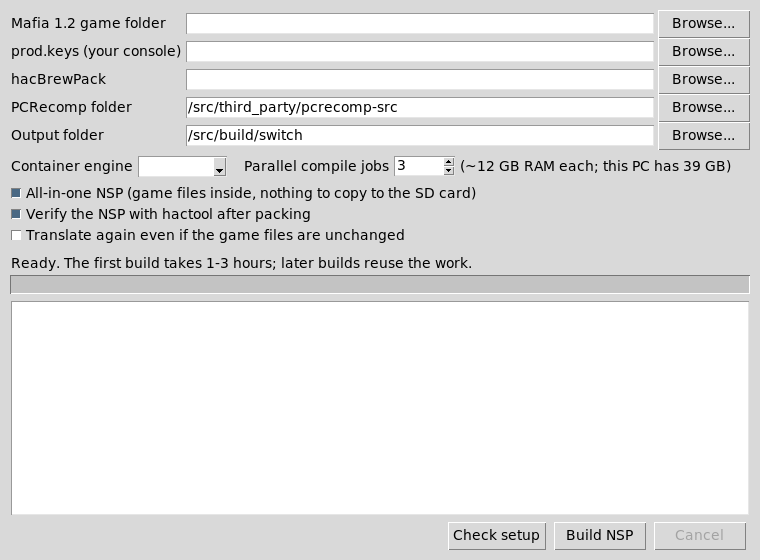

# Mafia on Nintendo Switch: build and install guide

This guide turns **your own copy** of *Mafia: The City of Lost Heaven* (PC, 1.2)
into a Switch NSP with the **NSP builder** (a small window app for Windows and
Linux), and installs it on a Switch running custom firmware.

> **No game files, and nothing made from them, are in this repository or its
> releases.** The builder translates *your* `Game.exe` on *your* PC. The NSP it
> makes contains code derived from your game (and, as an all-in-one NSP, the
> game itself): keep it for your own console. Never share or upload it.

## What you need

| | |
|---|---|
| **Switch** | Custom firmware: [Atmosphère](https://github.com/Atmosphere-NX/Atmosphere) with **sigpatches** (self-built NSPs are not signed by Nintendo), and an NSP installer such as DBI or Tinfoil. |
| **prod.keys** | Dumped from **your own** console with [Lockpick_RCM](https://github.com/shchmue/Lockpick_RCM). Used only to pack the NSP on your PC; never copied into the build or the NSP. |
| **Mafia 1.2 (PC)** | An installed, 1.2-patched game folder with an **unprotected** `Game.exe`. The Steam version is unprotected and tested; other unprotected 1.2 builds (GOG, the no-CD 1.2) should work but are untested. The original CD `Game.exe` is SafeDisc-encrypted and cannot be translated. |
| **PC** | Windows 10/11 or Linux, x86-64. **16 GB RAM minimum (32 GB recommended)**, about 30 GB free disk space, 1 to 3 hours for the first build. |
| **Software** | [Python 3](https://www.python.org/downloads/) (Windows: tick *Add python.exe to PATH*), [Git](https://git-scm.com/downloads), [Docker Desktop](https://www.docker.com/products/docker-desktop/) (Windows) or Docker/Podman (Linux), and [hacBrewPack](https://github.com/The-4n/hacBrewPack/releases) (`hacbrewpack.exe` on Windows; build it from source on Linux). |

## 1. Get the source

```sh
git clone --recursive https://github.com/csskillbad/Mafia-City-of-Lost-Heaven-Switch-Port
```

`--recursive` also fetches PCRecomp (the x86 translator, pinned version) into
`third_party/pcrecomp-src`. If you cloned without it, run
`git submodule update --init` inside the folder.

Windows: put `hacbrewpack.exe` into `tools\bin\` (or anywhere, and pick it in
the builder). Start Docker Desktop and wait until it says it is running.

## 2. Build the NSP

Start the builder:

- **Windows:** double-click `build_nsp_gui.bat`
- **Linux:** `./build_nsp_gui.sh` (needs `python3-tk`)



1. **Mafia 1.2 game folder:** the folder with `Game.exe`, `LS3DF.dll`, the
   `.dta` files and `sounds`.
2. **prod.keys:** your console's key file.
3. **hacBrewPack:** found automatically when it is on the PATH or in `tools/bin`.
4. **PCRecomp folder:** already filled in (the submodule).
5. **Parallel compile jobs:** each job needs up to ~12 GB of RAM. The builder
   suggests a safe number for your PC. With 16 GB use 1, with 32 GB use 2.
   Too many jobs runs your PC out of memory and the build fails.
6. **All-in-one NSP** (recommended): the game files go inside the NSP, so you
   install one file and copy nothing to the SD card. The NSP is then ~2.8 GB.
   Untick it for a ~150 MB NSP that reads the game from the SD card instead.
7. Click **Check setup**, then **Build NSP**.

What happens (the progress bar follows each step):

| Step | Time (8-core PC) |
|---|---|
| 0. Build image (first time only, downloads the devkitPro image, ~3 GB) | 5-15 min |
| 1. Translate `Game.exe` and the DLLs to C | 10-30 min |
| 2. Compile for Switch (about 120 files, a few are huge) | 1-3 h |
| 3. Stage | seconds |
| 4. Pack and sign with your prod.keys | 2-5 min |
| 5. Verify every hash in the NSP with hactool | 1-3 min |

The result is `build/switch/Mafia_full.nsp` (or `Mafia.nsp`). Later builds reuse
the translation and the compiled files, so they take minutes.

Command line instead of the window:

```sh
python3 tools/nsp_builder.py --cli --game /path/to/Mafia --keys /path/to/prod.keys --full --jobs 2
```

## 3. Install on the Switch

1. Copy the NSP to the console (DBI's MTP *Install* folder over USB, a USB
   stick, or the SD card) and install it with DBI or Tinfoil.
2. **Not all-in-one only:** copy the whole Mafia game folder to
   `sd:/switch/mafia/data/` (`Game.exe`, `LS3DF.dll`, `rw_data.dll`, `IJoy.dll`,
   every `.dta`, the videos, `sounds/`, ...).
3. Start **Mafia** from the HOME menu. Start it as a normal title, not from the
   album applet: the game needs full memory.

First start: the game asks for a profile name. The Switch keyboard opens by
itself: type the name and confirm, then press **D-pad down** to select **OK**
and press **A**. (Selecting the name field and pressing A opens the keyboard
again.)

## Settings

`sd:/switch/mafia/config.ini` (created on the first start, `KEY=VALUE` lines):

| Key | Default | |
|---|---|---|
| `LIMIT` | `60` | Frame limit: 60, 30 or 0 (none). |
| `VSYNC` | `0` | `1` waits for the screen refresh (drops to 30 when under 60). |
| `FPS` | `1` | FPS counter in the corner. |
| `CPU_CLOCK` | `1785` | CPU clock in MHz while playing (the Switch's own boost clock; back to normal on exit). `1020` saves battery, `0` leaves it to the system. |
| `TEXTURES` | `32` | `16` saves memory. |
| `MOVIES` | `1` | `0` skips the intro videos. |
| `WIDESCREEN` | `1` | 16:9 Hor+; `0` is the original 4:3. |
| `LOOK_SENS` | `30` | Right-stick camera speed. |
| `STATS` | `0` | `1` writes performance lines to `log.txt` every 5 s. |

Saves and settings live in `sd:/switch/mafia/userdata/`.

## Troubleshooting

| Problem | Fix |
|---|---|
| Build stops during *compile*, PC freezes | Out of memory: set **Parallel compile jobs** to 1 and build again (finished files are kept). |
| *hacBrewPack produced no NSP* | `prod.keys` is missing keys or is from a different/older dump: dump it again with the latest Lockpick_RCM. |
| *Verify* reports a failed hash | The disk or the copy is bad; build again. |
| Switch: "could not start software" / "corrupted" right after installing | Sigpatches are missing or older than your firmware/Atmosphère: update them. |
| Switch: the game closes back to HOME | Open `sd:/switch/mafia/log.txt` and report its last lines in an issue. The not-all-in-one NSP needs the complete game folder in `sd:/switch/mafia/data`. |
| Low frame rate in the city | Keep *Options -> Video -> Shadows* at *Very Low*, lower traffic density and draw distance; `LIMIT=30` gives a steadier picture. The CPU is the limit, so docked and handheld run about the same. |

## How it works

See [switch/README.md](../switch/README.md) (platform layer, memory, threads,
frame rate) and [ARCHITECTURE.md](ARCHITECTURE.md) (the translator and runtime).
